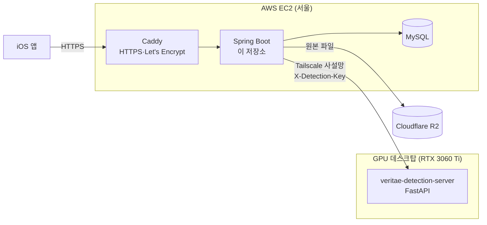

# Veritae Server

AI 기반 디지털 사기 예방·콘텐츠 신뢰도 분석 플랫폼 **Veritae**의 API 서버입니다.
사용자가 올린 이미지·음성·영상을 분석해 세 가지를 함께 알려 줍니다.

- **AI 판독**: AI로 만들거나 조작한 콘텐츠인지(딥페이크·합성 음성·생성 이미지)와 그 근거(히트맵, 의심 구간)
- **사기 위험도**: 화면 글자(OCR)나 말소리(STT)를 읽어 보이스피싱·스미싱 위험 점수와 판단 이유
- **가짜정보 탐지**: 내용 중 사실과 다른 주장을 한국어 위키백과 근거 문장·링크와 함께 표시

이 저장소는 회원·인증, 분석 요청 처리, 기록 저장을 맡는 Spring Boot 서버입니다. GPU가 필요한 모델 추론은
별도 저장소 [veritae-detection-server](https://github.com/sungbeenCho/veritae-detection-server)가 맡고,
iOS 앱은 [Veritae-iOS](https://github.com/IMCHO/Veritae-iOS)입니다.

## 구조



- 탐지 서버는 집 데스크탑 GPU에서 돌고, 클라우드 서버와는 Tailscale 사설망으로만 연결됩니다.
  탐지 서버는 공유 비밀 키(`X-Detection-Key`)를 확인해 이 서버의 요청만 받습니다.
- 이미지·음성은 결과가 나올 때까지 응답을 기다리는 방식(약 2분)이고, 영상은 처리 시간이 길어
  접수(202) 후 작업 ID로 결과를 조회하는 비동기 방식입니다.
- 분석 결과는 회원별로 저장되고, 원본 파일은 Cloudflare R2에 회원당 최신 10건까지 보관됩니다.
  탈퇴하면 DB 기록과 원본 파일을 함께 지웁니다.

### 분석에 쓰는 모델 (탐지 서버)

| 기능 | 모델 |
|---|---|
| 이미지 AI 판독 | SPAI (근거: attention 히트맵) |
| 음성 AI 판독 | AntiDeepfake (근거: 의심 시간 구간) |
| 영상 딥페이크 판독 | selimsef/dfdc (DFDC 우승 모델, 7개 앙상블, 근거: Grad-CAM 히트맵) |
| 글자 추출 | EasyOCR(이미지·영상 화면), faster-whisper large-v3(음성·영상 소리) |
| 사기 위험도·가짜정보 판정 | qwen3.5:4b (Ollama, 로컬 실행) |
| 가짜정보 근거 검색·확인 | 한국어 위키백과 색인(SQLite FTS5) + multilingual-e5, 직접 학습한 NLI 분류기·말한 사람 판별 분류기 |

유료 LLM API를 쓰지 않고 모든 모델을 데스크탑에서 로컬로 실행합니다(AntiDeepfake·EasyOCR은 CPU, 나머지는 GPU).

## 기술 스택

- Java 21, Spring Boot 4, Spring Security, Spring Data JPA
- JWT(jjwt) access/refresh 토큰
- OpenAPI 우선 설계: `openapi.yaml`에서 openapi-generator로 API 인터페이스·DTO 생성
- MySQL 8, Flyway(운영 스키마 관리)
- Cloudflare R2(AWS SDK S3 클라이언트)
- 운영: AWS EC2(Ubuntu 24.04, ARM), systemd, Caddy, Tailscale

## API

전체 명세는 [`src/main/resources/openapi.yaml`](src/main/resources/openapi.yaml)이며,
서버를 띄우면 `/swagger-ui/index.html`에서 볼 수 있습니다. 오류 응답은 RFC 9457(Problem Details) 형식입니다.

| Method | 경로 | 설명 |
|---|---|---|
| POST | `/api/v1/auth/signup` | 회원가입 |
| POST | `/api/v1/auth/login` | 로그인(access/refresh 토큰 발급) |
| POST | `/api/v1/auth/refresh` | access 토큰 재발급 |
| GET | `/api/v1/members/me` | 내 정보 |
| POST | `/api/v1/members/me/withdrawal` | 회원 탈퇴(기록·원본 삭제) |
| POST | `/api/v1/analysis/image` | 이미지 분석 |
| POST | `/api/v1/analysis/audio` | 음성 분석(최대 5분) |
| POST | `/api/v1/analysis/video` | 영상 분석 접수(202) |
| GET | `/api/v1/analysis/jobs/{jobId}` | 영상 분석 결과 조회 |
| GET | `/api/v1/analysis/records` | 내 분석 기록 목록 |
| GET | `/api/v1/analysis/records/{id}/media` | 분석 원본 다운로드(Range 지원) |
| GET | `/api/v1/analysis/report` | 내 분석 통계 |

## 패키지 구성

```
com.veritae.veritae_server
├── api          # openapi-generator 인터페이스 구현(Delegate)과 응답 매핑
├── auth         # 가입·로그인·토큰 재발급, JWT
├── security     # Spring Security 설정, 인증 실패 응답
├── analysis     # 이미지·음성·영상 분석 흐름, 기록·리포트, 영상 비동기 작업
├── detection    # 탐지 서버 호출 클라이언트(spai / antideepfake / dfdc)와 결과 타입
├── media        # 원본 파일 보관(R2, 미설정 시 비활성)
├── domain       # 엔티티·리포지토리(member, analysisrecord)
├── withdrawal   # 회원 탈퇴
├── config       # 탐지 서버·저장소·비동기 설정
└── common       # 전역 예외 처리
```

## 로컬 실행

필요한 것: JDK 21, MySQL 8(로컬 `root` / `1234`, DB `veritae`는 자동 생성)

```bash
./gradlew bootRun
```

로컬에서는 Hibernate가 스키마를 만들고(`ddl-auto=update`), 아래 환경변수는 모두 선택입니다.

| 환경변수 | 설명 | 비워 두면 |
|---|---|---|
| `JWT_SECRET` | JWT 서명 키 | 실행할 때마다 임시 키 생성(재시작하면 토큰 무효) |
| `DETECTION_SERVICE_URL` | 탐지 서버 주소 | 기본 주소 사용 |
| `DETECTION_API_KEY` | 탐지 서버 접근 키 | 키 헤더 없이 호출 |
| `R2_ACCOUNT_ID`, `R2_ACCESS_KEY_ID`, `R2_SECRET_ACCESS_KEY`, `R2_BUCKET` | 원본 보관 | 원본 보관·다운로드 비활성 |

분석 API를 실제로 쓰려면 탐지 서버가 켜져 있어야 합니다.

## 운영 배포

`prod` 프로필(`application-prod.properties`)은 DB 접속 정보·`JWT_SECRET`·탐지 서버 주소·접근 키를 기본값 없이
환경변수로만 받습니다. 하나라도 빠지면 시작 단계에서 실패하므로, 로컬 기본값(`root`/`1234`, 임시 JWT 키)으로 운영 서버가
뜨는 일이 없습니다. R2 설정은 운영에서도 선택이며, 비어 있으면 원본 보관만 꺼집니다.

- 스키마: Flyway(`src/main/resources/db/migration`)가 만들고, Hibernate는 검증(`validate`)만 합니다.
- 실행: systemd 서비스(전용 계정), `127.0.0.1:8080`에서만 받고 바깥 요청은 Caddy(HTTPS)를 거칩니다.
- 업로드 상한 110MB, 영상 업로드는 메모리 대신 임시 파일로 처리합니다.

## 테스트

```bash
./gradlew test
```

단위·슬라이스·통합 테스트 225개(JUnit 5, MockMvc, `@DataJpaTest` + H2).

## 설계 문서

- [`docs/decisions`](docs/decisions): 인증·회원, JWT·OpenAPI 생성 방식 결정 기록
- [`docs/superpowers/specs`](docs/superpowers/specs): 기능별 설계서(음성·영상 판독, 사기 위험도, 분석 기록, 가짜정보 탐지, 사기감지 LLM 약점 분석)
- [`docs/superpowers/plans`](docs/superpowers/plans): 기능별 구현 계획
